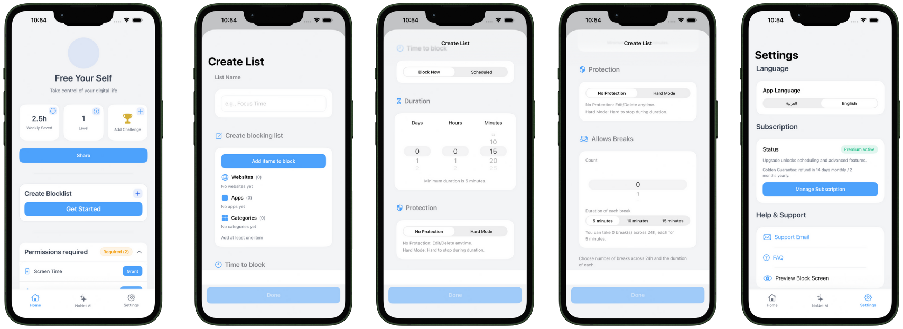

<div dir="rtl">

# تطبيق الصملة · Samla

**نظام حظر صارم لا يمكن تجاوزه أو تعطيله، لمعالجة الإدمان الرقمي.**
يحظر محتوى البالغين وتطبيقات المواعدة ومنصات القمار للأبد مجاناً، ويقلّل باقي صور الإدمان تدريجياً، مع بدائل صحية في مجتمع قائم.

> مشروع مشارك في **جائزة نورة الملاحي للابتكار الاجتماعي التقني 2026** · التحدي: الإدمان الرقمي · بدعم واحتضان من **ntdp**

   



## روابط سريعة

| | |
|---|---|
| 🌐 الموقع وكل الروابط | https://samla-app-links.vercel.app |
| 📱 صفحة التطبيق | https://samla-app-links.vercel.app/app |
| 🎞️ العرض التقديمي (18 شريحة) | https://samla-app-links.vercel.app/deck |
| ⬇️ العرض PDF | https://samla-app-links.vercel.app/samla-deck.pdf |
| 📄 ملف المشاركة | https://samla-app-links.vercel.app/submission |
| 📘 الدليل المجاني (36 صفحة) | https://samla-app-links.vercel.app/guide |

---

## المشكلة

| الرقم | المعنى | المصدر |
|---|---|---|
| **48.6%** | من مستخدمي الإنترنت في السعودية يقضون 7+ ساعات يومياً على الإنترنت | تقرير الإنترنت السعودي 2024، هيئة الاتصالات والفضاء والتقنية |
| **6h 38m** | متوسط الوقت اليومي على الإنترنت عالمياً، منها 2h 21m على وسائل التواصل | Digital 2025، DataReportal |
| **73%** | من المراهقين (13–17) شاهدوا محتوى للبالغين، و54% منهم قبل سن 13 | Common Sense Media، 2023 |

البدائل الحالية يمكن تعطيلها أو حذفها في لحظة الضعف، وأغلبها يضع الحماية خلف اشتراك.

## الحل: مساران حسب الاحتياج

**1. الحظر الدائم — مجاني للأبد**
زر واحد من أول شاشة يحظر محتوى البالغين وتطبيقات المواعدة ومنصات القمار. بعد التأكيد يتفعّل للأبد: لا تجاوز، ولا تراجع من داخل التطبيق، ولا حذف للتطبيق.

**2. تقليل الوقت — مدفوع**
اختر المواقع والتطبيقات، وحدد الوقت (من دقائق إلى أيام)، واختر مستوى الحماية: **Hard Mode** (لا يُلغى حتى ينتهي الوقت) أو **Normal Mode**.

### ما يميّزه عن البدائل
- **لا يُلغى من داخل التطبيق** — البدائل المعروفة تُعطَّل أو تُحذف بضغطة.
- **الحظر الأهم مجاني** — لا يقف المال بين الشخص وحمايته.
- **بالعربية وللسياق السعودي** — واجهة عربية/إنجليزية كاملة (RTL/LTR).
- **مجتمع قائم مربوط بالأداة** — مجتمع With Builders: 9 نوادٍ على واتساب يملأ فيها المستخدم الوقت المحرَّر.
- **يقيس الجودة لا الوقت فقط** — النوم والعلاقات، لا ساعات الشاشة وحدها.

## الفئة المستفيدة
المراهقون والشباب · طلاب الجامعات · البالغون عموماً · أولياء الأمور (نسخة عائلية مخططة، بعلم المستخدم دائماً ولا مراقبة سرية).

## قياس الأثر
لا نعلن أرقام أثر قبل قياسها. ستة مؤشرات من اليوم الأول:

| النوع | المؤشر |
|---|---|
| رئيسي | عدد من فعّلوا الحظر الدائم (عدّ مجهول الهوية) |
| الوقت | ساعات شاشة أقل على المحظور (قبل/بعد) · الوقت المستبدل |
| الجودة | النوم (1–5) · الجوال خارج الغرفة ليلاً · العلاقات (1–5) |

## الخصوصية والأمان
- الحظر يعمل **على الجهاز** عبر Screen Time API الرسمي من Apple، بلا خوادم، ويعمل بلا إنترنت بعد التفعيل.
- سجل التصفح **لا يغادر الجهاز**. لا تتبع ولا تحليلات خارجية (`NSPrivacyTracking = false`).
- الدفع عبر Apple فقط، لا بطاقات عندنا.
- ميزة شريك التعافي عبر CloudKit وApple ID، بدون خادم خاص.

## حالة المشروع
- ✅ نموذج أولي يعمل بالمسارين (الإصدار 1.4.0)
- ✅ صفحة هبوط بالعربية ودليل مجاني
- ✅ احتضان من ntdp
- 🔜 الإطلاق على iOS أولاً، ثم Android لاحقاً

---

## التقنيات

| الجانب | التقنية |
|---|---|
| الواجهة | SwiftUI، عربي/إنجليزي (RTL/LTR) |
| الحظر | FamilyControls · ManagedSettings · DeviceActivity (امتداد `BlockingMonitor`) |
| البيانات | Core Data محلياً · Keychain |
| الاشتراكات | StoreKit 2 |
| الحساب | Sign in with Apple |
| شريك التعافي | CloudKit |
| الاختبارات | 92 اختبار وحدة في `blocking appTests/` |

### بنية المشروع

```
blocking app/            التطبيق (SwiftUI)
├── Core/                المحرّك: BlockingEngine، StoreManager، PermissionsManager، CloudKitPartnerStore …
├── *View.swift          الشاشات: الرئيسية، إنشاء قائمة، الجدولة، الاشتراك، الإعدادات …
├── ar.lproj / en.lproj  الترجمة
└── PrivacyInfo.xcprivacy
BlockingMonitor/         امتداد DeviceActivity لتطبيق الحظر في الخلفية
blocking appTests/       اختبارات الوحدة
docs/                    وثائق التصميم والمراجعات وصفحات الويب القانونية
```

تفاصيل أكثر في [ARCHITECTURE.md](ARCHITECTURE.md) و[CHANGELOG.md](CHANGELOG.md).

### البناء والتشغيل
المتطلبات: macOS مع Xcode 15+ (يُفضّل 16+)، وجهاز iPhone حقيقي بـ iOS 16+ (Screen Time لا يعمل في المحاكي)، وحساب Apple Developer بصلاحية Family Controls.

```bash
git clone https://github.com/KxxLxD/NoNet-Last-one-with-Al-Garage.git
cd NoNet-Last-one-with-Al-Garage
open "blocking app.xcodeproj"
```

في Xcode: اختر هدف **blocking app**، وتأكد من قدرات Family Controls وSign in with Apple وIn-App Purchase، ثم `Cmd+R`.
لاختبار المشتريات محلياً: Edit Scheme ← Run ← Options ← StoreKit Configuration ← `blocking app/Products.storekit`.

---

## الفريق والتواصل
**م. خالد بن خميس** — المؤسس
📧 EngKhalidKhamis@gmail.com · 🌐 https://samla-app-links.vercel.app

## الرخصة
© 2026 خالد بن خميس. **جميع الحقوق محفوظة.** الكود متاح للاطلاع والتقييم فقط، ولا يجوز نسخه أو استخدامه أو إعادة توزيعه دون إذن كتابي. التفاصيل في [LICENSE](LICENSE).

</div>

---

## English summary

**Samla** is an iOS app that tackles digital addiction with blocking that cannot be bypassed in a weak moment. A free, one-tap **permanent block** covers adult content, dating apps and gambling; it can't be undone from inside the app and the app can't be deleted. A paid **time-reduction** mode adds Hard/Normal blocking for chosen apps and sites. Everything runs on-device via Apple's Screen Time API (FamilyControls, ManagedSettings, DeviceActivity): no servers, no tracking, payments through Apple only.

Built with SwiftUI, Core Data, StoreKit 2, Sign in with Apple and CloudKit. Entry for the **Noura Al-Mallahi Award for Technical Social Innovation 2026**, incubated by ntdp.

Website: https://samla-app-links.vercel.app · Pitch deck (PDF): https://samla-app-links.vercel.app/samla-deck.pdf

© 2026 Khalid bin Khamis. All rights reserved. Source is visible for review only; see [LICENSE](LICENSE).
