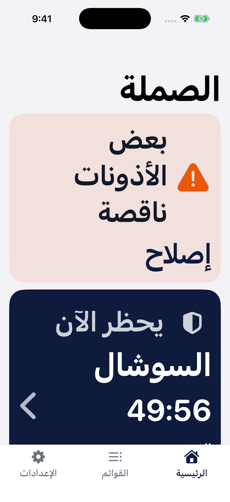
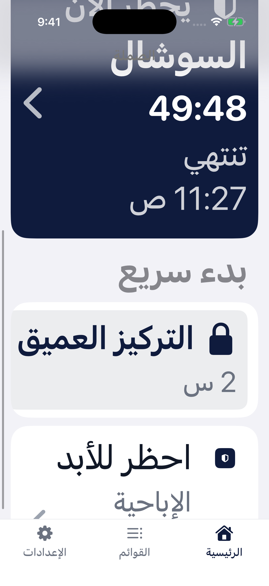
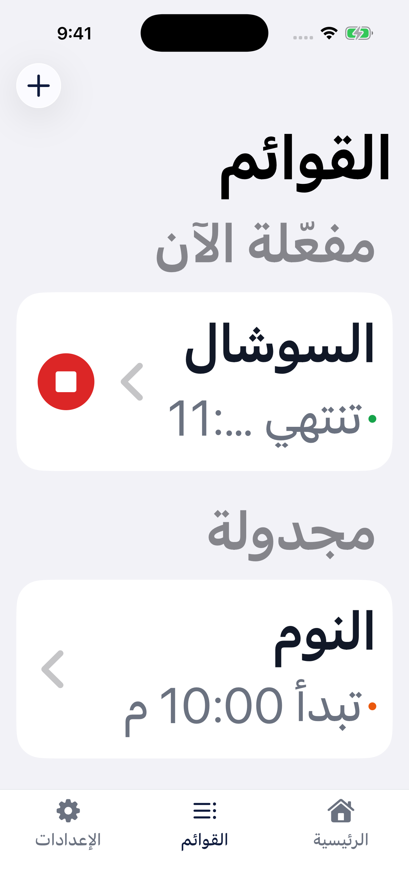
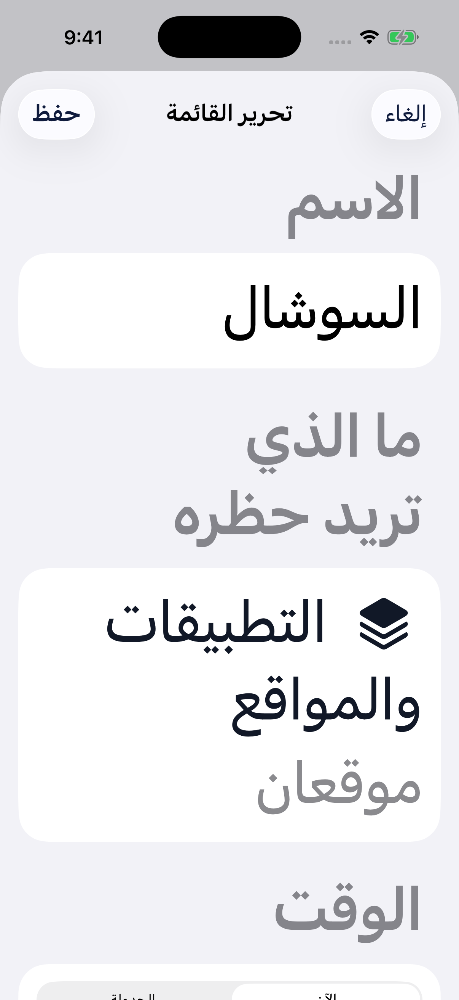
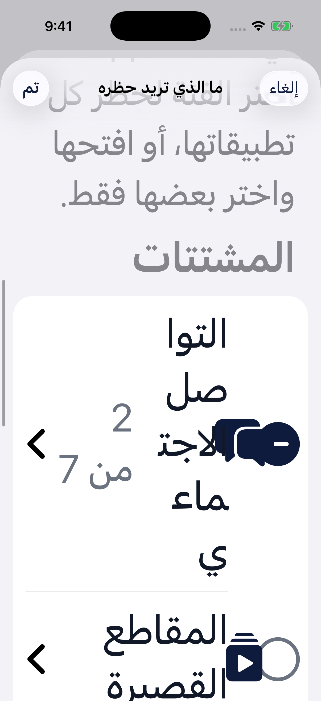
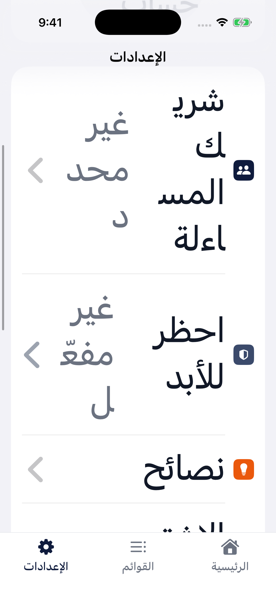
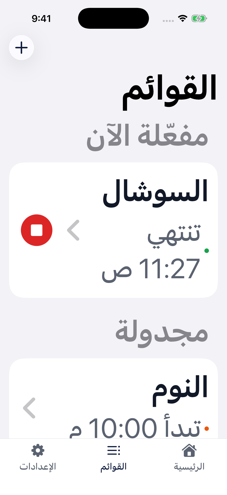
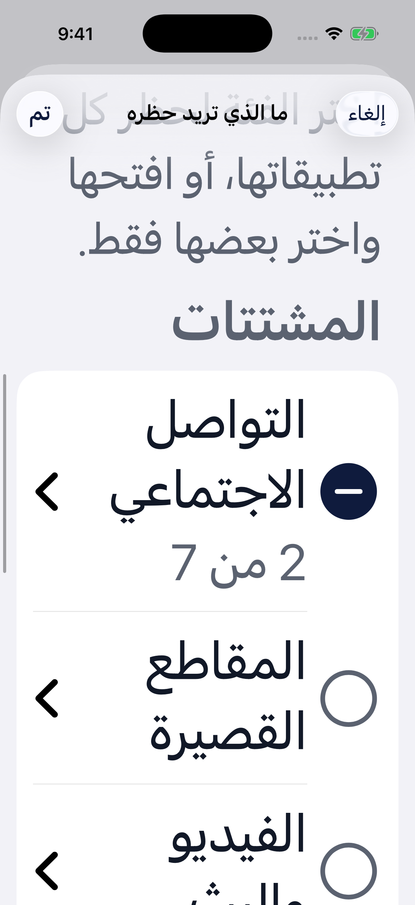
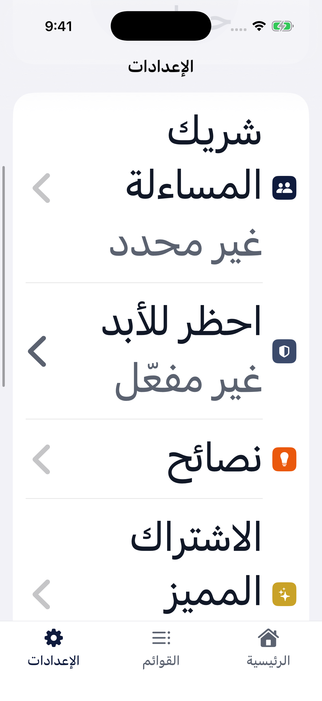
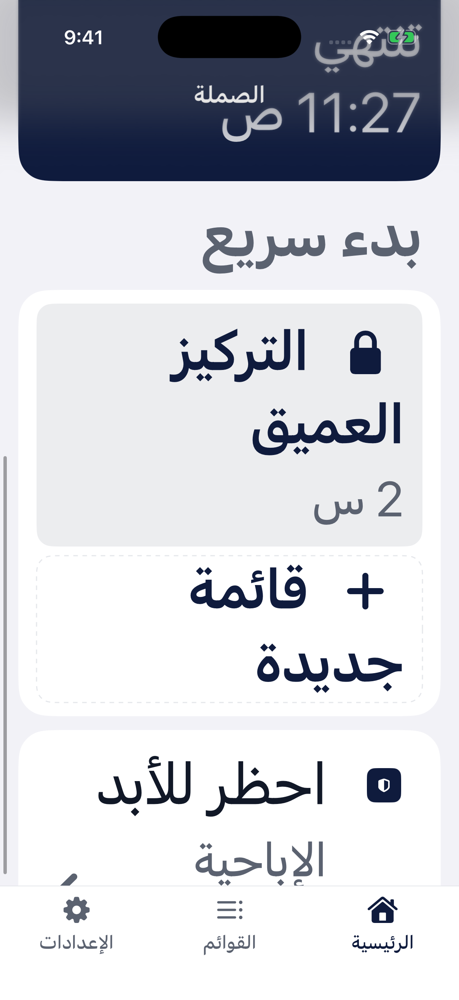

# فحص إمكانية الوصول — الصملة (Samla)
**المعيار:** WCAG 2.1 AA (+ إرشادات Apple للوصول) | **التاريخ:** 2026-10-17 | **الإصدار:** `381e0c3`

> **المنهج:** فحص كل شاشات SwiftUI في الكود + قياس تباين كل زوج ألوان + تشغيل التطبيق بالعربي على محاكي iPhone 17 Pro بأكبر حجم خط (AX5، أكثر من 200%).
> **حدود الفحص:** VoiceOver و«الوصول الكامل بلوحة المفاتيح» ما يشتغلون على المحاكي من أدواتي — نتائج قارئ الشاشة مبنية على الكود وسلوك SwiftUI الافتراضي، وتحتاج جولة VoiceOver على جهاز حقيقي للتأكيد (مُعلَّمة ⚠️).

---

## ✅ حالة الإصلاح (2026-10-17) — كل البنود الـ21 أُصلحت
| البند | ما تغيّر | التحقق |
|---|---|---|
| P1–P3، O3 | تخطيط عمودي في أحجام الوصول: صفوف الفئات (بدون أيقونة، العدد تحت العنوان)، صفوف الإعدادات (القيمة تحت العنوان)، سطر الحالة يلتف بدل القطع، البدء السريع عمودي بعرض كامل، صفوف الأذونات | ✅ محاكي AX5 — صور 07–10 |
| P4–P6، P10 | `textSecondary` ← `#5B6270` (5.49:1 على الرمادي)، `activeText` ← `#166534`، نص أحمر جديد `dangerText` `#B91C1C` (رسائل التحقق، «إيقاف»، أخطاء الرمز)، الأسهم بالرمادي الجديد | ✅ قياس البكسل: عنوان القسم `#5B6270` |
| P5 | كل عناوين وتذييلات الأقسام (48) عبر `.sectionCaption()` | ✅ |
| P7، P9 | إخفاء الصور الزخرفية والفواصل «·» عن قارئ الشاشة | كود |
| P8 | صفة «عنوان» لعناوين الـOnboarding، اسم القائمة، الحالات الفاضية، Premium | كود |
| O1 | بطاقة «يحظر الآن» صارت `NavigationLink` حقيقي + `navigationLinkIndicatorVisibility(.hidden)` | ✅ الضغط يفتح القائمة |
| O2 | زر ▶/⏹ بمساحة لمس 44 نقطة؛ شرائح المدة بارتفاع 44 | كود |
| O4 | «تقليل الحركة»: انتقال تلاشي في الـOnboarding والإشعار السفلي، وبدون ارتداد الأيقونة | كود |
| U1 | أسماء حقيقية للحقول: «الاسم»، «الموقع»، «اسم الشريك» + النص التوضيحي كـ`prompt` | كود |
| U2 | نص التقدّم المرئي مخفي عن قارئ الشاشة (الشريط يقوله) | كود |
| R1 | `Announcer` يعلن: تم الإنشاء/التحديث، أخطاء التحقق، الرمز الخاطئ/القفل، إضافة موقع/خطأ صيغته، بدء/إيقاف/استراحة/تخطّي/استئناف، تفعيل «احظر للأبد» | كود |
| R2 | «حظر كل التواصل الاجتماعي» + القيمة «2 من 7» | كود |
| R3 | عدّاد الاستراحات عنصر واحد قابل للتعديل بالسحب للأعلى/الأسفل | كود |
| R4 | شريط التبويبات بصفة `.isTabBar` والأيقونات مخفية | كود |
| R5 | شريحة البدء السريع تعلن «الوضع الصارم» | كود |

> ⚠️ **باقي:** جولة VoiceOver و«الوصول الكامل بلوحة المفاتيح» على آيفون حقيقي لتأكيد بنود قارئ الشاشة (ما تشتغل على المحاكي).

---

## الملخص (قبل الإصلاح)
**المشاكل:** 21 | **حرجة:** 1 | **كبيرة:** 10 | **صغيرة:** 10

أساس التطبيق جيد: مكونات Apple الأصلية، الحالات ما تعتمد على اللون وحده، أزرار الأيقونات لها أسماء، وتم إصلاح التباين وأحجام اللمس في الجولة السابقة. **أكبر مشكلتين:** (1) بعض الشاشات تنكسر عند تكبير الخط (محتوى يختفي أو يتداخل)، و(2) قارئ الشاشة ما يُبلَّغ بالرسائل المهمة (تم الإنشاء، خطأ الرمز، أخطاء التحقق).

---

## النتائج

### قابلية الإدراك (Perceivable)
| # | المشكلة | المعيار | الخطورة | الإصلاح |
|---|---|---|---|---|
| P1 | **صفوف «ما الذي تريد حظره» تنكسر بالخط الكبير:** علامة الاختيار تتداخل مع أيقونة الفئة، والعنوان ينكسر حرفاً حرفاً («التوا/صل/الاجت/ماء/ي») — صورة 05 | 1.4.4 تكبير النص | 🔴 حرجة | في أحجام الوصول: إخفاء أيقونة الفئة، ونقل العدد «2 من 7» تحت العنوان (`dynamicTypeSize.isAccessibilitySize`)؛ عرض الأيقونة بـ`@ScaledMetric` بدل 24 ثابت. `BlockItemsEditorView.swift` › `categoryRow` |
| P2 | **وقت الانتهاء يختفي في القوائم بالخط الكبير:** «تنتهي 11:…» مقطوع بسبب `lineLimit(1)` — صورة 03 | 1.4.4 | 🟡 كبيرة | `StatusLine`: سطرين أو بدون حد في أحجام الوصول. `Components.swift` |
| P3 | **صفوف الإعدادات تكسر الكلمات بالخط الكبير:** العنوان والقيمة جنب بعض («شريـ/ك المسـ/اءلة»، «غير محـ/د») — صورة 06 | 1.4.4 | 🟡 كبيرة | `row()` في الإعدادات: ترتيب عمودي (العنوان ثم القيمة) في أحجام الوصول، زي `LabeledContent`. `SettingsView.swift` |
| P4 | **النص الثانوي `#6B7280` على خلفية الصفحة الرمادية = 4.33:1** (يحتاج 4.5): وصف الـOnboarding، تفاصيل الحالة في صفحة القائمة، الحالات الفاضية، وصف Premium، مرجع الآية | 1.4.3 التباين | 🟡 كبيرة | تغميق `AppColors.textSecondary` إلى `#5B6270` (6.13 على الأبيض، 5.49 على الرمادي) |
| P5 | **عناوين وتذييلات الأقسام الافتراضية من iOS = 3.29:1** — وهي اللي تشرح الحماية والحدود والأخطاء | 1.4.3 | 🟡 كبيرة | نمط موحّد للتذييلات بلون `textSecondary` الجديد (Apple نفسها ما تحقق 4.5 هنا) |
| P6 | **نص «مفعّلة الآن» الأخضر = 4.49:1** على الرمادي (رأس صفحة القائمة)، و**الأحمر `#DC2626` = 4.33:1** (رسائل التحقق في التذييلات + نص زر «إيقاف») | 1.4.3 | 🟡 كبيرة | `activeText` ← `#166534` (6.39)، ولون نص أحمر جديد `#B91C1C` (5.80) للنصوص؛ الأحمر الزاهي يبقى للخلفيات |
| P7 | صور زخرفية تُقرأ بصوت عالٍ: نجوم Premium، درع الآية، أيقونة الشريك في ورقة الرمز، شعار Apple في الحساب، أسهم (احظر للأبد في الرئيسية، زر «احظرها نهائياً»، «خيارات إضافية»)، الكرة الأرضية بجانب حقل المواقع | 1.1.1 | 🟢 صغيرة | `.accessibilityHidden(true)` على كل واحدة |
| P8 | عناوين بصرية غير معلّمة كعناوين: عناوين الـOnboarding، اسم القائمة في صفحتها، «لا يوجد حظر نشط الآن» | 1.3.1 | 🟢 صغيرة | `.accessibilityAddTraits(.isHeader)` |
| P9 | فاصل «·» يُقرأ «نقطة» بين الحالة والتفاصيل | 1.3.1 | 🟢 صغيرة | إخفاؤه عن قارئ الشاشة |
| P10 | أسهم التنقل `#9CA3AF` = 2.54:1 (عنصر غير نصي) | 1.4.11 | 🟢 صغيرة | `textSecondary` للأسهم |

### قابلية التشغيل (Operable)
| # | المشكلة | المعيار | الخطورة | الإصلاح |
|---|---|---|---|---|
| O1 | ⚠️ **بطاقة «يحظر الآن» في الرئيسية:** الرابط مخفي بـ`opacity(0)` (حيلة إظهار السهم الأبيض) — SwiftUI يُخفي العناصر الشفافة عن VoiceOver ولوحة المفاتيح، فالبطاقة تُقرأ كنص بدون «زر» | 2.1.1 / 4.1.2 | 🟡 كبيرة | `NavigationLink { المحتوى }` عادي + `.navigationLinkIndicatorVisibility(.hidden)` (متاح من iOS 17) + السهم الأبيض داخل المحتوى. `HomeView.swift` |
| O2 | **زر ▶/⏹ في صفوف القوائم ~28 نقطة** (أقل من 44) | 2.5.5 | 🟡 كبيرة | `.frame(minWidth: 44, minHeight: 44).contentShape(Rectangle())`. `ListsView.swift` › `ListRow` |
| O3 | شرائح المدة ~36 نقطة ارتفاعاً؛ وشريط «بدء سريع» الأفقي يُخفي «قائمة جديدة» خارج الشاشة بالخط الكبير بدون مؤشر تمرير — صورة 02 | 2.5.5 | 🟢 صغيرة | ارتفاع 44 للشرائح؛ ترتيب عمودي للبدء السريع في أحجام الوصول |
| O4 | حركات لا تحترم «تقليل الحركة» (ارتداد أيقونة الـOnboarding، انتقالات الدفع) | 2.3.3 (AAA) | 🟢 صغيرة | `@Environment(\.accessibilityReduceMotion)` لتعطيلها |

### قابلية الفهم (Understandable)
| # | المشكلة | المعيار | الخطورة | الإصلاح |
|---|---|---|---|---|
| U1 | **الحقول تستخدم النص التوضيحي كاسم:** «مثال: النوم»، «مثال: example.com»، «مثال: أحمد» — VoiceOver يقرأ «مثال: النوم» بدل «الاسم»، والنص يختفي عند الكتابة (تباينه 1.74:1) | 3.3.2 / 4.1.2 | 🟡 كبيرة | `TextField("Name", text:, prompt: Text("e.g., Sleep"))` — نفس النمط لحقل الموقع واسم الشريك |
| U2 | التقدّم في الـOnboarding يُقرأ مرتين («1 من 4» للشريط + النص بجانبه) | 1.3.1 | 🟢 صغيرة | إخفاء النص المرئي عن قارئ الشاشة |

### المتانة (Robust)
| # | المشكلة | المعيار | الخطورة | الإصلاح |
|---|---|---|---|---|
| R1 | **رسائل الحالة ما تُعلَن لقارئ الشاشة:** «تم إنشاء القائمة» (تختفي بعد 1.2 ث مع الورقة)، أخطاء التحقق، «رمز خاطئ / محاولات متبقية»، خطأ صيغة الموقع، تخطّي/استئناف/بدء/إيقاف | 4.1.3 | 🟡 كبيرة | `AccessibilityNotification.Announcement("…").post()` (إطار `Accessibility`) عند كل رسالة |
| R2 | **زر «حظر الكل» في كل فئة ما يذكر اسم الفئة** — VoiceOver يقول «حظر الكل، زر» عشر مرات بدون سياق | 4.1.2 / 2.4.6 | 🟡 كبيرة | `.accessibilityLabel("Block all \(category)")` + `accessibilityValue("3 من 7")` |
| R3 | **عدّاد «الاستراحات في اليوم»:** زرّي − و+ منفصلين («إضافة»/«إزالة») والقيمة نص ثالث — ما فيه عنصر واحد بقيمة قابلة للتعديل | 4.1.2 | 🟡 كبيرة | الصف كعنصر واحد: الاسم + القيمة + `accessibilityAdjustableAction` (سحب للأعلى/الأسفل) |
| R4 | شريط التبويبات المخصص بدون صفة «شريط تبويبات»، وأيقونة كل تبويب تُقرأ مع اسمه | 4.1.2 | 🟢 صغيرة | `.accessibilityAddTraits(.isTabBar)` على الحاوية + إخفاء الأيقونات |
| R5 | شريحة «بدء سريع» لقائمة صارمة ما تُعلن أنها «الوضع الصارم» (القفل مرئي فقط) | 1.3.1 | 🟢 صغيرة | `.accessibilityValue(list.protection.title)` |

---

## فحص التباين
| العنصر | النص | الخلفية | النسبة | المطلوب | النتيجة |
|---|---|---|---|---|---|
| النص الأساسي | `#111827` | أبيض / `#F2F2F7` | 17.7 / 15.9 | 4.5 | ✅ |
| العناوين والأزرار الكحلية | `#0F1B3D` | أبيض | 16.9 | 4.5 | ✅ |
| أبيض على الكحلي (البطاقة، الأزرار) | `#FFFFFF` | `#0F1B3D` | 16.9 (80%: 11.1) | 4.5 | ✅ |
| أبيض على الأحمر (زر «فهمت، ابدأ») | `#FFFFFF` | `#DC2626` | 4.83 | 4.5 | ✅ |
| النص الثانوي | `#6B7280` | أبيض | 4.83 | 4.5 | ✅ |
| النص الثانوي | `#6B7280` | `#F2F2F7` | **4.33** | 4.5 | ❌ |
| عناوين/تذييلات iOS الافتراضية | secondaryLabel | `#F2F2F7` | **3.29** | 4.5 | ❌ |
| «مفعّلة الآن» | `#15803D` | أبيض / رمادي | 5.02 / **4.49** | 4.5 | ✅ / ❌ |
| «مجدولة» | `#C2410C` | أبيض / رمادي | 5.18 / 4.64 | 4.5 | ✅ |
| رسائل الخطأ، نص «إيقاف» | `#DC2626` | `#F2F2F7` | **4.33** | 4.5 | ❌ |
| النص التوضيحي في الحقول | tertiaryLabel | أبيض | **1.74** | 4.5* | ❌ |
| أسهم التنقل | `#9CA3AF` | أبيض | **2.54** | 3.0 | ❌ |
| أيقونة التحذير في الشريط | `#EA580C` | برتقالي 12% | 3.07 | 3.0 | ✅ |
| نقاط الحالة (برتقالي/أخضر) | — | أبيض | 3.56 / 3.30 | 3.0 | ✅ |
| أيقونات الإعدادات الملونة | أبيض | ذهبي/رمادي | 2.42 / 2.54 | — | ➖ زخرفية بجانب نص |
| مسار مفتاح التبديل المطفأ (iOS) | `#E9E9EA` | أبيض | 1.21 | 3.0 | ➖ عنصر نظام (iOS يوفّر «تسميات تشغيل/إيقاف») |

\* يصير تلميحاً فقط بعد إصلاح U1.

---

## التنقل بلوحة المفاتيح (Full Keyboard Access على iOS)
| العنصر | ترتيب التنقل | Space/Enter | Escape | الأسهم |
|---|---|---|---|---|
| شريط التبويبات المخصص | ✅ من اليمين لليسار | ✅ يبدّل التبويب | — | — |
| بطاقة «يحظر الآن» | ⚠️ قد تُتخطى (رابط شفاف) | ⚠️ | — | — |
| شرائح «بدء سريع» | ✅ | ✅ (تأكيد للمحمية) | — | ✅ تمرير أفقي |
| الأوراق (تأكيد، محرر، رمز الشريك) | ✅ التركيز داخل الورقة | ✅ | ✅ إلغاء/إغلاق | — |
| فئات «ما الذي تريد حظره» | ✅ العلامة ثم الصف | ✅ حظر الكل / فتح | — | — |
| العجلات (المدة المخصصة، الجدول) | ✅ | — | — | ✅ تغيير القيمة |
| حذف بالسحب (القوائم، المواقع) | ✅ عبر قائمة الإجراءات | ✅ | — | — |

## قارئ الشاشة (VoiceOver) — متوقع من الكود ⚠️
| العنصر | يُعلَن كـ | المشكلة |
|---|---|---|
| زر ▶ في صف القائمة | «ابدأ السوشال، زر» | ✅ |
| زر + في القوائم | «إنشاء قائمة، زر» | ✅ |
| قفل القائمة المقفلة | «مقفلة» | ✅ |
| علامة «حظر الكل» | «حظر الكل، زر» | ❌ بدون اسم الفئة (R2) |
| صف موقع داخل فئة | «ChatGPT, chatgpt.com، محدد، زر» | ✅ |
| حقل اسم القائمة | «مثال: النوم، حقل نص» | ❌ الاسم الصحيح «الاسم» (U1) |
| عدّاد الاستراحات | «إزالة، زر» · «0» · «إضافة، زر» | ❌ (R3) |
| بطاقة «يحظر الآن» | «يحظر الآن، السوشال، 49:56…» بدون «زر» | ❌ (O1) |
| «تم إنشاء القائمة» | لا شيء | ❌ (R1) |
| «رمز خاطئ، 4 محاولات متبقية» | لا شيء حتى ينتقل التركيز | ❌ (R1) |
| تبويب الرئيسية | «الرئيسية، منزل، محدد، زر» | ⚠️ أيقونة مقروءة + بدون «تبويب، 1 من 3» (R4) |
| أيقونة نجوم Premium | «نجوم» | ❌ زخرفية (P7) |

---

## ما يعمل بشكل ممتاز
- الحالات **ما تعتمد على اللون**: نقطة + نص، وعلامات الاختيار بأشكال مختلفة (دائرة/ناقص/صح).
- أزرار الأيقونات لها أسماء (▶/⏹، +، القفل، الحماية)، والاختيار له صفة «محدد» (الشرائح، المواقع، التبويبات).
- عارض المحتوى الكبير على التبويبات + حد أقصى لحجم خط الشريط.
- شريط الأذونات يتحول عمودي بالخط الكبير، والمحرر والرئيسية يتكيفون بشكل سليم (صور 01، 04).
- أحجام 44 نقطة لزر الرجوع، عدّاد الاستراحات، علامات الفئات.
- التحقق من النموذج يكتب الخطأ نصاً مع أيقونة (3.3.1 ✅).
- مكونات النظام (القوائم، النماذج، العجلات، التنبيهات، الأوراق) تعطي دعم VoiceOver ولوحة المفاتيح مجاناً، والحذف بالسحب له بديل في صفحة القائمة.
- ترتيب القراءة صحيح من اليمين لليسار في كل الشاشات.

---

## أولويات الإصلاح
1. **تكبير الخط بدون فقدان محتوى (P1–P3)** — يأثر على ضعاف البصر وكبار السن، ويعطّل صفحة «ما الذي تريد حظره» بالكامل عندهم. تخطيط عمودي في أحجام الوصول لثلاث مكونات.
2. **إعلانات قارئ الشاشة (R1) + أسماء الحقول (U1)** — مستخدمو VoiceOver حالياً ما يعرفون إن القائمة انحفظت أو إن الرمز خاطئ. أسطر قليلة لكل رسالة.
3. **التباين (P4–P6)** — ثلاث درجات أغمق في `AppColors` + نمط موحد للتذييلات يحل كل إخفاقات النص.
4. **أسماء العناصر (R2، R3، O1، O2)** — «حظر الكل + الفئة»، العدّاد كعنصر قابل للتعديل، بطاقة الرئيسية كزر حقيقي، وزر ▶ بحجم 44.
5. **الصغيرة (P7–P10، O3، O4، U2، R4، R5)** — إخفاء الزخارف، العناوين، صفة شريط التبويبات، تقليل الحركة.

> **بعد الإصلاح:** جولة VoiceOver على آيفون حقيقي (إنشاء قائمة من البداية للنهاية، تشغيل قائمة صارمة، إدخال رمز الشريك) + «الوصول الكامل بلوحة المفاتيح» لتأكيد البنود ⚠️.

## الصور
| | |
|---|---|
|  الرئيسية AX5 ✅ |  بدء سريع AX5 |
|  القوائم — وقت مقطوع ❌ |  المحرر AX5 ✅ |
|  ما الذي تريد حظره — تداخل ❌ |  الإعدادات — كلمات مكسورة ❌ |

### بعد الإصلاح (AX5)
| | |
|---|---|
|  القوائم — الوقت كامل ✅ |  الفئات مقروءة ✅ |
|  الإعدادات — القيمة تحت العنوان ✅ |  البدء السريع عمودي ✅ |
