# فحص تجربة الاستخدام — الصملة (Samla)

> التاريخ: 2026-10-17 · الفرع: `refactor/project-structure` (مع التعديلات غير المحفوظة)
> المنهج: قراءة كل شاشات SwiftUI + تشغيل التطبيق على محاكي iPhone 17 Pro (iOS 26) **بالعربي** + قياس تباين الألوان (WCAG 2.2) + اختبار كبر الخط (Dynamic Type).
> المرحلة: صقل قبل TestFlight — لذلك التركيز على ما يؤذي المستخدم أو يربكه في أول استخدام.
> الصور في نفس المجلد.

### ✅ ما تم إصلاحه (2026-10-17)
- **U1 + U2 + U7:** تشغيل أي قائمة محمية يمر بورقة «بدء القائمة؟» (المدة + وقت الانتهاء + تحذير + زر أحمر «فهمت، ابدأ») من النقاط الأربع؛ زر الرئيسية الكبير يكتب اسم القائمة؛ شارة 🔒/👥 على الشرائح والصفوف. — `StartConfirmationSheet.swift`
- **U3:** عجلات المدة صارت شرائح جاهزة (25 د · 1 س · 2 س · 4 س · 8 س · يوم) + «مخصص» يفتح العجلات في ورقة منفصلة.
- **U4:** «تم» في الجدولة يضيف الأيام المختارة تلقائيًا، ومعطّل إذا ما فيه شيء.
- **الترجمة:** النصوص العشرة + الجديدة مترجمة، حُذفت 11 مفتاح قديم، واختبار `everyStringHasAnArabicTranslation` يمنع التكرار.
- **إضافي (اكتُشف أثناء التحقق):** بعد الضغط على «ابدأ» كانت القائمة تظهر «متوقفة» حتى 30 ثانية (تاريخ `TimelineView` قديم) — صارت تتحدث فورًا.

---

## الانطباع العام

الأساس قوي: هوية هادئة (كحلي + رماديات)، استخدام سليم لمكوّنات Apple الأصلية، دعم ممتاز للعربية واتجاه RTL، وتصميم ذكي لمنع التحايل في الشريك و«احظر للأبد».
**أكبر فرصة:** التطبيق مبني على «الالتزام» (الوضع الصارم، احظر للأبد)، لكن بعض أخطر الأفعال تتم **بلمسة واحدة بدون تأكيد**، وبعض المدخلات (عجلات المدة) تتغير بالخطأ أثناء التمرير. هذي أهم من أي تحسين بصري.

---

## 1. الانطباع الأول (أول ثانيتين)

| الشاشة | ما يجذب العين أولاً | صحيح؟ |
|---|---|---|
| الترحيب | الدرع + «مرحبًا بك في الصملة» | ✅ واضح ونظيف، يشبه إعداد أجهزة Apple |
| الرئيسية | **شريط وردي بالإنجليزي** «Some permissions are missing» ثم بطاقة الحظر الكحلية | ❌ أول ما يقرأه المستخدم العربي نص إنجليزي بلون تحذيري — يعطي انطباع «تطبيق غير مكتمل» |
| القوائم | بطاقات بحالات ملوّنة | ✅ مفهوم فورًا |
| الإعدادات | بطاقة الشعار + شارات «No partner / No account» بالإنجليزي | ⚠️ نفس مشكلة الترجمة |

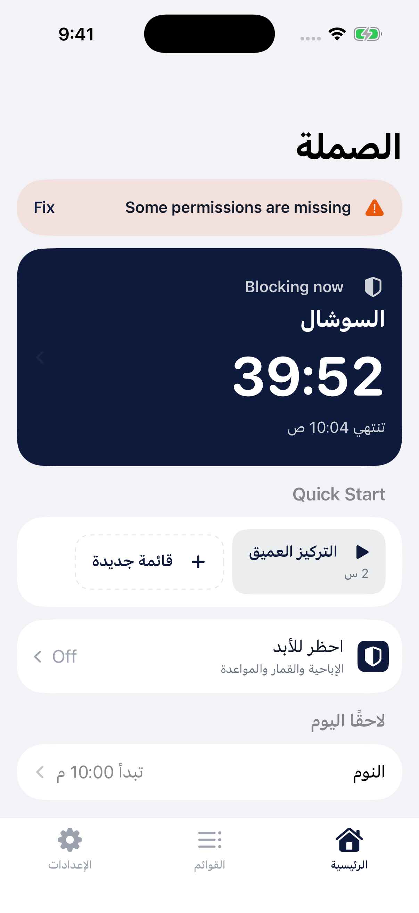

---

## 2. سهولة الاستخدام

| # | الملاحظة | الخطورة | التوصية |
|---|---|---|---|
| U1 | **تشغيل قائمة محمية بلمسة واحدة بدون تأكيد.** زر Quick Start في الرئيسية، زر ▶ في صف القائمة، و«ابدأ» في التفاصيل كلها تشغّل قائمة «الوضع الصارم» فورًا — والمدة قد تصل **30 يومًا** بلا تراجع. جرّبتها على المحاكي: لمسة واحدة → «2:00:00» وزر التعديل والإيقاف والحذف معطّلة (صورة 08). والأسوأ: `sorted()` يضع القوائم المحمية **أولاً** في Quick Start، فهي الأقرب للمس الخاطئ. | 🔴 حرجة | أي تشغيل لقائمة `protection != .none` يمر بورقة تأكيد مثل ورقة الملخص الحالية: الاسم + المدة + «تنتهي 11:25 ص» + زر أحمر «فهمت، ابدأ». ضع شارة 🔒 على الشريحة والصف. وفكّر باستبعاد القوائم الصارمة من Quick Start. المواضع: `HomeView.swift:140` و`:246`، `ListsView.swift:114`، `ListDetailView.swift:134` |
| U2 | **زر «ابدأ الحظر» الكبير في الرئيسية لا يقول أي قائمة سيشغّل** — يشغّل «آخر قائمة مستخدمة»، وقد تكون صارمة. | 🔴 حرجة | اكتب الاسم على الزر: «ابدأ «التركيز» · 2 س»، أو افتح قائمة اختيار سريعة. |
| U3 | **عجلات المدة تخطف التمرير.** في شاشة «قائمة جديدة»، العجلات الثلاث تملأ عرض النموذج؛ سحبة واحدة لتمرير الصفحة غيّرت «الأيام» من 0 إلى **28 يومًا** (صورة 10). مع الوضع الصارم هذا قفل شهر كامل بالخطأ. | 🔴 حرجة | استبدل العجلات بشرائح جاهزة (25 د · 1 س · 2 س · 4 س · 8 س · يوم) + «مخصص…» تفتح ورقة فيها العجلات. على الأقل أبرز المدة بلون مختلف في ورقة الملخص عندما تتجاوز يومًا. `ListEditorView.swift:263` |
| U4 | **محرر الجدولة يضيّع اختيار المستخدم بصمت.** المستخدم يختار الأيام والوقت ثم يضغط «تم» — لكن لا شيء يُحفظ ما لم يضغط «إضافة فترة» أولاً. (من قراءة الكود: `ScheduleEditorSheet.swift:70` يحفظ `working` ويتجاهل `selectedDays`). | 🔴 حرجة | «تم» يضيف الاختيار المعلّق تلقائيًا. والأفضل تبسيط الشاشة: شرائح أيام (أحد…سبت) + «من/إلى» = جدول واحد، و«أضف وقتًا آخر» للحالات المتقدمة. أضف قوالب: «كل ليلة 10م–6ص»، «أيام العمل 9–5». |
| U5 | زر «إنشاء» معطّل بدون أي توضيح للسبب (الاسم حرفين، تطبيقات/مواقع، وقت صالح). | 🟡 متوسطة | اترك الزر فعّالاً، وعند الضغط مرّر إلى الحقل الناقص وأبرزه، أو اعرض سطرًا: «ينقصك: اختر تطبيقات أو مواقع». `ListEditorView.swift:82` |
| U6 | خيار «الشريك» في الحماية يبدو فعّالاً بصريًا لكن الضغط عليه لا يفعل شيئًا عند عدم وجود شريك. | 🟡 متوسطة | اعرضه رماديًا بوضوح + رابط مباشر «أضف شريكًا» بدل الإحالة النصية للإعدادات. `ListEditorView.swift:185` |
| U7 | صفوف القوائم لا تُظهر نوع الحماية — القائمة الصارمة تبدو مطابقة للعادية (صورة 06). | 🟡 متوسطة | شارة صغيرة 🔒/👥 بجانب الاسم. |
| U8 | القائمة المقفلة: «إيقاف» و«حذف» رمادية، والسبب مكتوب في تذييل قسم آخر. | 🟡 متوسطة | استبدل الأزرار بصف واحد: «🔒 مقفلة حتى 11:25 ص — الوضع الصارم». `ListDetailView.swift:140` |
| U9 | عند الوصول لحد 3 قوائم، صفحة Premium فيها «أعلمني» فقط — لا طريق للأمام. ولا يعرف المستخدم بالحد قبل الضغط على +. | 🟡 متوسطة | في تذييل القوائم: «2 من 3 قوائم مجانية». وفي صفحة Premium زر ثانوي «إدارة قوائمي». |
| U10 | رسالة ما قبل إذن Screen Time تقول «لا يرى الصملة نشاطك»، ثم رسالة Apple تقول إنه «يسمح له برؤية بيانات نشاطك» (صورة 03) — تناقض في أهم لحظة إذن. | 🟡 متوسطة | استبق الرسالة: «رسالة Apple عامة وتذكر بيانات النشاط، لكن Apple تخفيها عن الصملة. وستطلب رمز الجهاز.» `OnboardingView.swift:117` |
| U11 | في «احظر للأبد» تحذير «يقفل معها تطبيقات عادية +17» مخفي تحت زر «فهمت، فعّل» (صورة 12). | 🟡 متوسطة | ضع الزر فوق خلفية `.bar`/مادة، أو انقل التحذير فوق المفتاح. `ForeverSetupView.swift:45` |
| U12 | «حذف الحساب والبيانات» يظهر حتى بدون حساب، ويعيد الـOnboarding. | 🟢 بسيطة | بدون حساب: «حذف كل بياناتي». `AccountSection.swift:53` |
| U13 | صفوف تخرج من التطبيق (اللغة ← إعدادات iOS، الدعم ← المتصفح) تستخدم سهم التنقل الداخلي. | 🟢 بسيطة | أيقونة `arrow.up.forward` للروابط الخارجية. `SettingsView.swift:55` |
| U14 | القائمة المجدولة الشغالة (بدون حماية) لا يمكن إيقافها اليوم إلا بتعديل الجدول. | 🟢 بسيطة | خيار «تخطَّ اليوم» للقوائم غير المحمية. |
| U15 | الأسئلة الشائعة تشير إلى «خيارات إضافية» غير موجودة في المحرر، و«بطاقة الأذونات» صارت شريطًا. | 🟢 بسيطة | حدّث النص في `FAQView.swift:24`. |

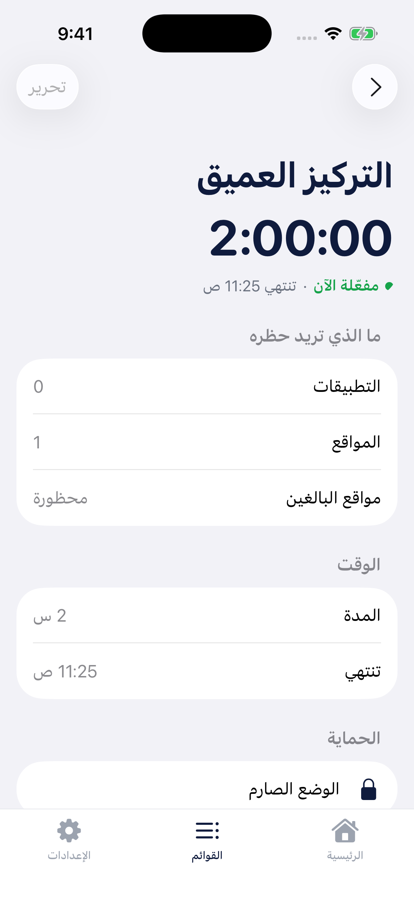 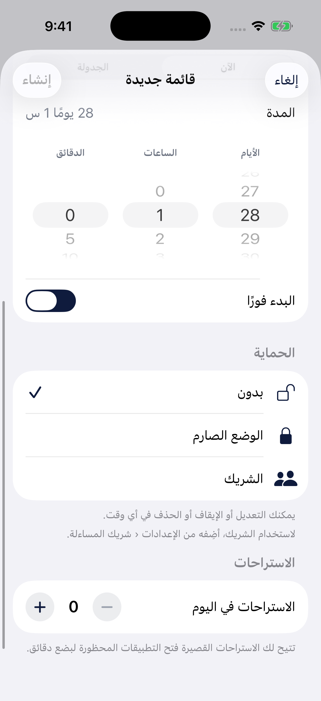

---

## 3. التسلسل البصري

- **ما يجذب العين أولاً في الرئيسية:** بطاقة «يحظر الآن» الكحلية والعدّاد الكبير — ✅ صحيح، هذا قلب التطبيق. لكن الشريط الوردي فوقها ينافسها، ولونه (أحمر فاتح) يوحي بخطأ بينما هو تنبيه.
- **مسار القراءة:** العنوان ← شريط الأذونات ← بطاقة الحظر ← Quick Start ← احظر للأبد ← لاحقًا اليوم. منطقي.
- **التركيز:**
  - السهم داخل بطاقة الحظر **رمادي غامق على كحلي** — شبه غير مرئي، فلا يعرف المستخدم أن البطاقة قابلة للضغط. `.tint(.white)` لا يلوّن سهم `NavigationLink`. (`HomeView.swift:102`)
  - شريحة القائمة الصارمة في Quick Start بنفس وزن أي شريحة — يجب أن تكون مميزة (قفل) أو غير موجودة.
  - في تفاصيل القائمة، الفعل الأساسي «ابدأ/إيقاف» نص عادي في آخر الصفحة تحت الطيّة. الخطة (PLAN.md §7) تصفه كزر بارز `[ أوقف ]`.
- **التكرار:** في شاشة القوائم، عنوان القسم «مفعّلة الآن» يتكرر حرفيًا في سطر الحالة تحت الاسم (صورة 06). احذف كلمة الحالة من الصف واترك التفاصيل («تنتهي 10:04 ص»).
- **بطاقة رأس الإعدادات** تكرر معلومات موجودة في الصفوف تحتها (الشريك/الحساب) — قيمتها قليلة.

---

## 4. الاتساق

| العنصر | المشكلة | التوصية |
|---|---|---|
| الترجمة | **10 نصوص بلا ترجمة عربية**، كلها في أول شاشتين: `Blocking now` · `Fix` · `Quick Start` · `Some permissions are missing` · `Start a list and stay focused.` · `Off` · `No account` · `No partner` · `Signed in` · `Partner on`. + 11 مفتاح قديم (stale) لم يعد مستخدمًا. | أضفها في `Localizable.xcstrings`، واحذف القديمة، وأضف اختبارًا يفشل عند وجود مفتاح بلا `ar`. |
| ألوان التأكيد | ورقة ملخص القائمة تستخدم **زرًا أحمر** عند إضافة حماية (ساعة واحدة مثلاً)، بينما «احظر للأبد» (360 يومًا) يستخدم **كحلي**. | قاعدة واحدة: كل «التزام لا رجعة فيه» = نفس الأسلوب. |
| ألوان أيقونات الإعدادات | الأخضر للأسئلة والدعم، والبرتقالي للنصائح — بينما الأخضر = «شغالة» والبرتقالي = «مجدولة/تحذير» في بقية التطبيق. | أيقونات الإعدادات بدرجات الكحلي/الرمادي فقط، واحتفظ بالأخضر/البرتقالي للحالات. |
| الخلفية | الـOnboarding وورقة رمز الشريك تستخدم `systemGroupedBackground`، والتصميم يعرّف `AppColors.background` (#F3F4F6). | اعتمد رمزًا واحدًا. |
| شريط التبويبات | شريط مخصص، بينما الخطة تقول «Liquid Glass» — شريط iOS 26 الأصلي هو Liquid Glass مجانًا. | ارجع لـ`TabView` الأصلي مع `.tint`. (انظر أيضًا قسم الوصول) |
| المسمّيات | «الاستراحات في اليوم» في المحرر مقابل «كل 24 ساعة» في الأسئلة الشائعة. | مصطلح واحد. |
| أيقونة الإشعارات | `bell.badge.fill` أحادية اللون تجعل النقطة تلتصق بالجرس ككتلة (الخطوة 4). | `.symbolRenderingMode(.hierarchical)` أو `bell.fill`. |
| صفوف «قريبًا» | «المجتمع» و«Premium» صفوف بلا فائدة الآن. | أخفِ «المجتمع» حتى يجهز — الصفوف الميتة تقلل الثقة وقد تلفت مراجعة Apple. |

---

## 5. إمكانية الوصول

### تباين الألوان (WCAG AA: نص عادي ≥ 4.5)

| اللون | الاستخدام | النسبة على الأبيض | الحكم | البديل المقترح |
|---|---|---|---|---|
| `#9CA3AF` stopped | تسميات التبويبات غير المختارة، حالة «متوقفة»، أيقونات | **2.54** | ❌ | `#6B7280` (4.83) |
| `#16A34A` active | نص «مفعّلة الآن» | **3.30** | ❌ | `#15803D` (5.02) |
| `#EA580C` scheduled | نص «مجدولة»، تحذير الـOnboarding | **3.56** (و2.85 على خلفيته الفاتحة) | ❌ | `#C2410C` (5.18) |
| `#6B7280` textSecondary | على خلفية القوائم الرمادية | 4.33 | ⚠️ حدّي | `#4B5563` للنص الصغير |
| أبيض على `#C9A227` | أيقونة Premium | 2.42 | ❌ (أيقونة) | `#A16207` |
| `#0F1B3D` على الأبيض | العناوين والأزرار | 16.9 | ✅ | — |

> اقتراح: افصل «لون النقطة» (يبقى زاهيًا) عن «لون النص» (درجة أغمق) في `AppColors`.

### أحجام اللمس (≥ 44×44 نقطة)
- زر الرجوع في الـOnboarding: **36×36** (`OnboardingView.swift:62`).
- أزرار − / + للاستراحات: **36×36** (`ListEditorView.swift:247`).
- كبّرها لـ44 أو أضف `.contentShape` بمساحة أكبر.

### كبر الخط (Dynamic Type)
- عند أحجام الوصول الكبيرة (صورة 13): نص شريط الأذونات **ينكسر وسط الكلمة** («permissi/ons»)، وتسميات التبويبات تتضخم حتى تلامس حافة الشاشة.
- الشريط المخصص يفقد ما يقدمه شريط iOS مجانًا: **Large Content Viewer** (الضغط المطوّل يكبّر التبويب)، وإعلان VoiceOver «تبويب، 1 من 3».
- الحل: `TabView` الأصلي، أو على الأقل `.accessibilityShowsLargeContentViewer()` + `.dynamicTypeSize(...DynamicTypeSize.xxLarge)` على الشريط، و`ViewThatFits`/`VStack` للشريط في أحجام الوصول.
- العدّادات (52 و48 نقطة) ثابتة الحجم — مقبول للأرقام، لكن الأفضل `@ScaledMetric`.

### أخرى
- ✅ الحالات لا تعتمد على اللون فقط (نقطة + نص).
- ✅ الأيقونات الزخرفية مخفية عن VoiceOver، وأزرار الأيقونات لها `accessibilityLabel`.
- ⚠️ الوضع الداكن مقفول (`UIUserInterfaceStyle = Light`) — قرار موثق في الخطة لـv1، لكن شاشة الحظر البيضاء ليلاً ستكون مزعجة لقائمة «النوم» تحديدًا. ضعه أولوية لـv1.1.

---

## 6. ما يعمل بشكل ممتاز

- **العربية وRTL متقنة:** أسهم الرجوع تنقلب صح، ترتيب العجلات (أيام←ساعات←دقائق) يقرأ من اليمين، شريط التقدم يمتلئ من اليمين، والأرقام الغربية موحّدة في كل مكان.
- **Onboarding محترم:** يشرح Screen Time قبل رسالة Apple، لا يمكن تخطيه بالسحب خطأً، فيه تقدم ورجوع، وحالة رفض الإذن لها طريق للعودة.
- **ورقة الملخص قبل الحفظ** مع تحذير واضح وزر «فهمت، فعّل» — نمط ممتاز (المطلوب فقط تعميمه على «ابدأ»).
- **تصميم الشريك ضد التحايل:** «سلّم الجوال لأحمد»، قفل بعد محاولات خاطئة، رسالة الواتس لا ترسل الرمز أبدًا، تغيير الشريك يحتاج رمزه، و«نسيت الرمز» بانتظار 7 أيام. تفكير ناضج.
- **مكونات Apple الأصلية** (List/Form/ContentUnavailableView) تعطي مقاسات النظام ودعم الخط تلقائيًا.
- **الخصوصية** رسالتها متسقة في كل مكان («كل شيء على جهازك»).
- **النبرة الروحانية** في «احظر للأبد» وشاشة الحظر مميزة وتفرّق التطبيق عن المنافسين.

---

## 7. أولويات التنفيذ

1. **تأكيد قبل تشغيل أي قائمة محمية + شارة قفل** (U1، U2، U7) — يمنع أسوأ تجربة ممكنة: قفل أيام بالخطأ ثم حذف التطبيق بتقييم نجمة واحدة. نفس ورقة الملخص الموجودة، تُستدعى من نقاط التشغيل الأربع.
2. **إكمال الترجمة العربية + اختبار يمنع تكرارها** — 10 نصوص في أول شاشتين؛ إصلاح دقائق بأثر كبير على الانطباع الأول.
3. **إعادة تصميم مدخلات الوقت** (U3، U4) — شرائح مدة جاهزة بدل العجلات، و«تم» في الجدولة يحفظ ما اختاره المستخدم.
4. **تباين الألوان** — ثلاث درجات نص أغمق في `AppColors` تحل معظم إخفاقات WCAG.
5. **شريط التبويبات الأصلي** — يحل الوصول وكبر الخط ويعطي Liquid Glass المذكور في الخطة.

---

## الصور

| | |
|---|---|
| 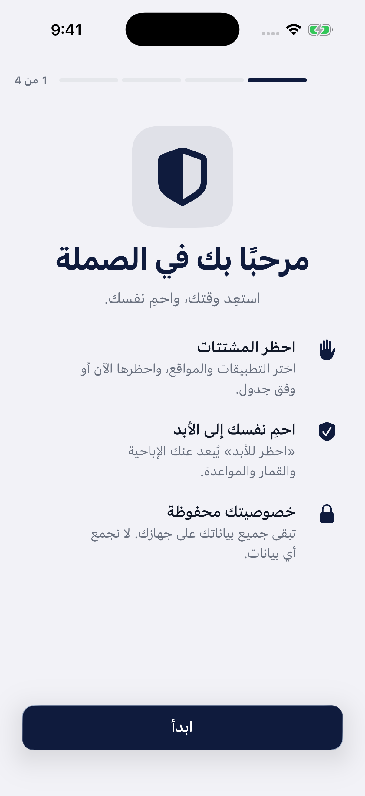 الترحيب | 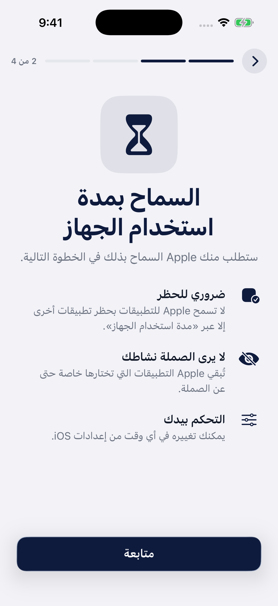 إذن Screen Time |
| 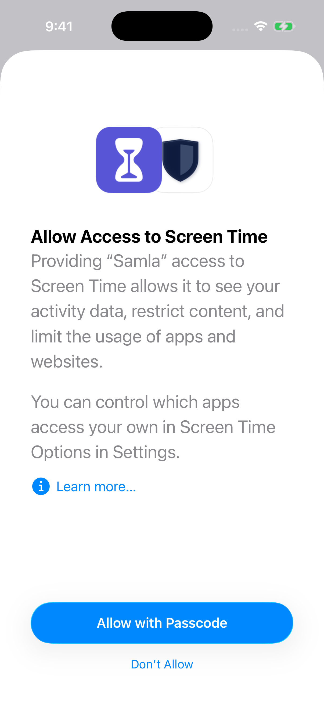 رسالة Apple | 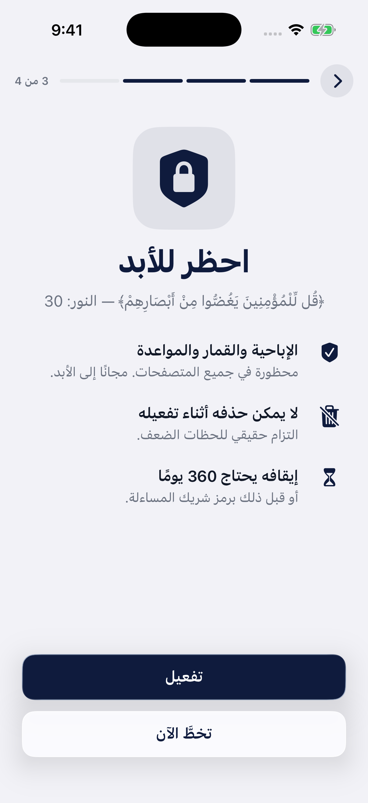 احظر للأبد |
|  الرئيسية | 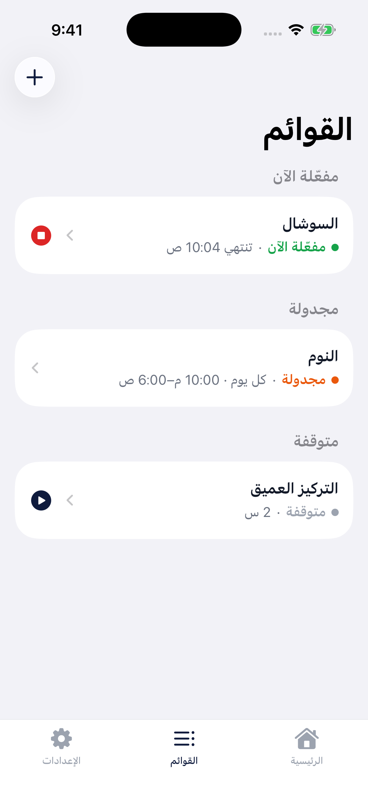 القوائم |
| 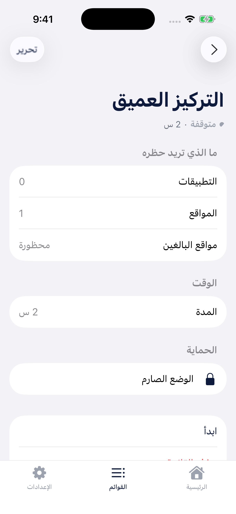 قائمة صارمة قبل التشغيل |  بعد لمسة واحدة |
| 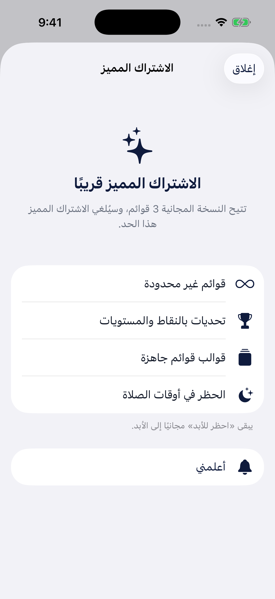 حد القوائم |  العجلة غيّرت المدة |
| 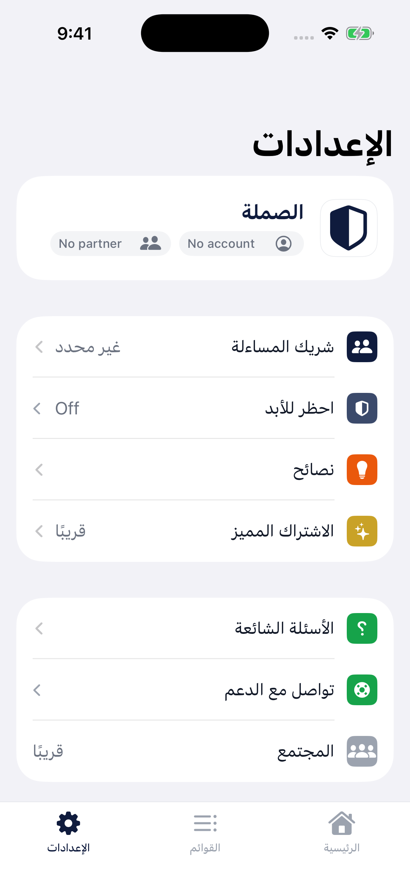 الإعدادات | 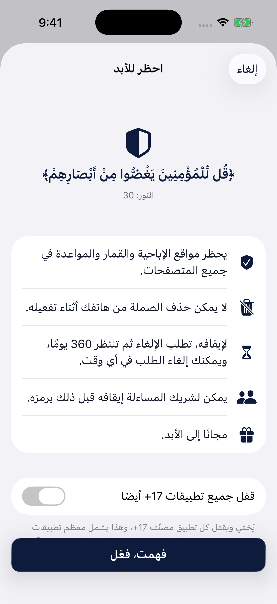 تفعيل احظر للأبد |
| 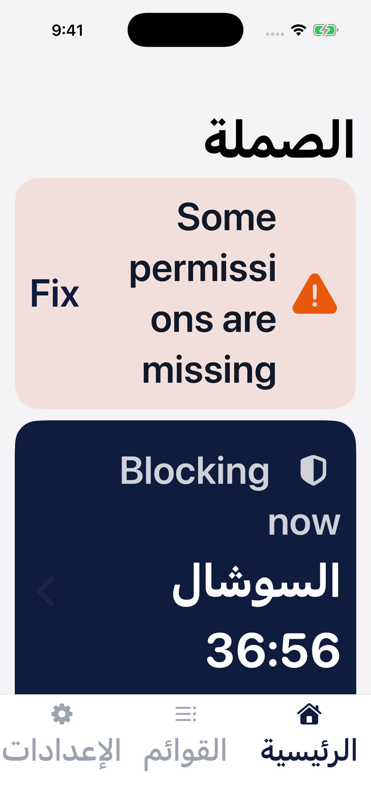 خط كبير | |

> ملاحظة: لم يُختبر الحظر الفعلي وشاشة الحظر (Shield) لأنها لا تعمل على المحاكي — راجعتها من الكود فقط. البند U4 مُستنتج من الكود ولم يُجرَّب على المحاكي.
